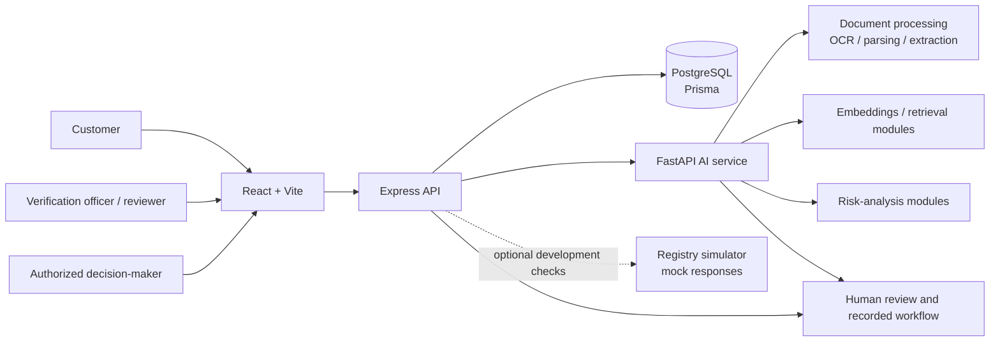

<div align="center">
  

  # FinPulse-AI

  ### Verify Smarter. Assess Faster. Lend Better.

  **AI-assisted loan verification and decision support**
</div>

---

## About the project

FinPulse-AI is a hackathon-stage fintech prototype exploring how a lending workflow can bring customer onboarding, document collection, verification, AI-assisted analysis, and staff review together in one application.

Loan applications can involve information spread across forms, identity and financial documents, reference records, and review systems. FinPulse-AI is intended to help organize that information, extract useful fields from supported documents, highlight items that may need attention, and give authorized staff a place to review the available evidence.

The project also explores **quantum-assisted loan portfolio optimization** as a longer-term research direction: selecting a candidate set of loans under shared capital and other portfolio constraints. This is a product vision, not a claim that a QUBO/QAOA optimizer is implemented in this repository.

> **Important:** FinPulse-AI is a prototype, not a bank, credit bureau, or production loan-origination system. AI output is decision support, not proof of identity, fraud, creditworthiness, or eligibility. Authorized people must review evidence and retain responsibility for lending decisions. The application does not approve or disburse real loans.

## Contents

- [Project goals](#project-goals)
- [What is in this repository](#what-is-in-this-repository)
- [Architecture](#architecture)
- [User roles and workflow](#user-roles-and-workflow)
- [Data boundaries and privacy](#data-boundaries-and-privacy)
- [Loan applications and document wallet](#loan-applications-and-document-wallet)
- [AI verification and human review](#ai-verification-and-human-review)
- [Interface and accessibility direction](#interface-and-accessibility-direction)
- [Quantum-assisted optimization](#quantum-assisted-optimization)
- [Technology stack](#technology-stack)
- [Setup](#setup)
- [Configuration](#configuration)
- [Run the services](#run-the-services)
- [Validation](#validation)
- [Known limitations and roadmap](#known-limitations-and-roadmap)
- [Security](#security)
- [Acknowledgements](#acknowledgements)
- [Acknowledgements](#acknowledgements)

## Project goals

FinPulse-AI is designed to explore four connected ideas:

1. **Application workflow:** provide customer-facing registration, onboarding, document submission, and application-status screens.
2. **Document verification assistance:** use the existing AI-service components to process documents and surface extracted information or potential issues for review.
3. **Staff review:** make application information and verification outcomes available to authorized staff through review-oriented screens.
4. **Portfolio research:** investigate whether a constrained loan-selection problem can be formulated and evaluated using QUBO/QAOA, alongside a classical baseline.

The product principle is:

> **AI helps organize and examine evidence. Optimization may explore candidate portfolios. People make the lending decisions.**

### Feature status at a glance

| Capability | Status in this repository |
| --- | --- |
| React web application with customer, officer, reviewer, and administration screens | Implemented in the UI; backend authorization and individual workflows still require end-to-end validation |
| Express API, authentication routes, and PostgreSQL/Prisma integration | Implemented; local configuration and integration dependencies are required |
| FastAPI AI service with document, extraction, embedding, RAG, and risk-related modules | Present in the codebase; model/provider configuration and the full workflow must be validated in the target environment |
| Government-style registry simulator | Optional development service; responses are mock data, not official records |
| Separate bank-customer reference database integration | Not included as a ready-to-run, shareable data source in this repository |
| Three-store production data architecture | Design direction; do not assume that three independently deployed data stores are already configured |
| QUBO/QAOA loan-portfolio optimizer and measured quantum/classical comparison | Planned research direction; not found as an implemented optimizer in this repository |
| Production lending, credit decisioning, or loan disbursement | Not implemented |

The table describes repository contents and maturity, not a production-readiness assessment. Features must be tested with configured services before being relied on.

## What is in this repository

| Path | Purpose |
| --- | --- |
| `frontend/` | React and Vite web application |
| `backend/` | Node.js and Express API, Prisma schema, authentication, verification, and workflow routes |
| `ai-service/` | Python FastAPI service and document/AI processing modules |
| `COMPLYGeM-Government-Data-Simulator/` | Optional mock registry API for development and integration experiments |
| `database/` | Database artifacts retained from the original project scaffold; inspect before using them with the current backend |

The interface has been reworded for a loan-verification experience. Some internal role values, endpoints, and model fields retain names from the earlier procurement-verification prototype to preserve compatibility.

## Architecture



The frontend communicates with the backend over HTTP. The backend owns application API and authorization boundaries, persists relational data through Prisma, and can coordinate with the AI service. The Python service exposes its API through FastAPI. The registry simulator is optional and must not be confused with a live bank or government integration.

### Main service addresses

| Service | Default local address |
| --- | --- |
| Frontend | `http://localhost:5173` |
| Express API | `http://localhost:5000` |
| API health check | `http://localhost:5000/api/health` |
| FastAPI service | `http://localhost:8000` |
| FastAPI interactive documentation | `http://localhost:8000/docs` |
| Optional registry simulator | `http://localhost:8001` |

## User roles and workflow

The interface and API are organized around customer and staff workflows. Exact permission assignments depend on backend role configuration; never treat a hidden frontend control as an authorization boundary.

### Customer / borrower

The customer-facing experience includes account access, onboarding, profile and document workflows, application-related screens, and status information. A customer should only be able to access their own records; verify this through backend authorization tests before using any non-synthetic data.

The intended customer workflow includes:

- Registering and signing in, then viewing account and application status.
- Starting an application and providing information relevant to the selected product.
- Uploading required supporting files and following verification progress.
- Responding to requests for corrections or additional information.
- Viewing decisions communicated by the institution.

These are product goals, not a guarantee that every step is fully connected in the current prototype. Loan-specific forms and requirements should be configurable: education, home, and personal loans are possible examples, not universal lending policies.

### Verification officer / reviewer

Staff-facing screens support reviewing customer information, documents, verification findings, and follow-up needs. A mismatch or model flag is a prompt for inspection—not proof of fraud or a final lending decision.

An intended officer workflow includes inspecting the source document alongside extracted fields, understanding missing or potentially inconsistent information, recording review notes, and requesting correction or further evidence where appropriate. Officer access must be enforced by the backend and tested against each role.

### Administrator / authorized decision-maker

Administrative and review functions are exposed through role-oriented screens. The exact separation between an administrator, verification officer, and bank manager is still a product and authorization decision to validate; this repository should not be assumed to implement a production bank approval hierarchy.

An institution's authorized decision-maker should be able to consider officer findings, relevant policy checks, and any portfolio analysis before recording a decision with reasons. Optimization output, when available, is a candidate-analysis aid—not an approval or rejection instruction.

### Registration and contact verification

The intended registration flow collects only the information needed for the agreed account-matching and contact-verification process. Do not collect PAN during initial registration unless a separately defined and justified workflow requires it. OTP is only verified delivery when an OTP provider is configured; a local/demo path must be labelled clearly and must not claim that an email or SMS was sent when it was not.

Reference-record matching should reveal only the minimum necessary result and should not disclose whether arbitrary account identifiers belong to another person. The repository contains development workflows, not a verified live bank-customer integration.

### Intended application lifecycle

```text
Draft / registration
        ↓
Application submitted
        ↓
Document processing and verification checks
        ↓
Officer review ───────→ More information requested
        ↓                           ↓
Further authorized review ← Updated submission
        ↓
Human decision recorded
```

This is the intended product flow. Confirm the available transitions and permission checks in the running backend before treating the diagram as a complete workflow specification.

Possible customer-facing statuses include draft, submitted, document processing, officer review, more information requested, and a communicated decision. Their exact names and allowed transitions must be defined and validated server-side; internal enum values should not be exposed as confusing technical messages.

## Data boundaries and privacy

The project brief distinguishes three kinds of data. Keeping their purposes separate is an important design goal:

1. **Government-style reference data:** development-only mock records exposed through the optional simulator. These are not official government records or live government APIs.
2. **Bank-customer reference data:** intended for controlled matching during a prototype registration or verification flow. A shareable, ready-to-run bank reference dataset is not included here. Do not add real account or customer records to Git.
3. **FinPulse-AI application data:** operational accounts, applications, document metadata, verification outcomes, review notes, and audit/workflow information managed by the application services.

These are logical data boundaries and a design goal; do not infer that three separately deployed databases or a complete production data-isolation model are already configured. The checked-in backend uses PostgreSQL through Prisma, and the AI service has its own database configuration. Review their configuration before connecting them to real services.

Use only fabricated test data. Do not query arbitrary account references, expose another customer's records, or return more reference-record fields than a verification operation requires. Avoid displaying complete account or identity numbers in the UI, URLs, and logs.

### Intended separation of the three data sources

| Logical data source | Intended purpose | Current-repository note |
| --- | --- | --- |
| Government-style reference data | Synthetic/mock checks for development workflows | Optional simulator; not a live government service |
| Bank-customer reference data | Controlled matching against synthetic bank customer records | No ready-to-share bank reference dataset is included |
| FinPulse-AI application data | Accounts, application records, document metadata, review outcomes, and audit events | Backend uses PostgreSQL with Prisma; confirm which workflows persist data in each service |

The frontend must never connect directly to database credentials or receive bulk private reference datasets. Whether these logical stores are deployed as separate databases, schemas, or isolated services is an architecture decision that must be verified; this README does not claim that three production databases are already provisioned.

## Loan applications and document wallet

The product vision supports different loan products with configurable application forms and document requirements. For example, an education-loan form may request course and institution details, while a home-loan form may request property information. These examples are not universal financial requirements; lenders must define their own approved fields and policies.

The intended document wallet is customer-scoped and should show document type, upload time, processing/review status, and expiry or replacement needs where applicable. Reuse of an older document should depend on policy and validity, not happen automatically. Documents and their extracted contents are untrusted input and should be accessible only through authorized paths.

**Implementation caveat:** the current Express document-upload route writes files to a local `uploads/` directory and accepts files up to 50 MB. That is a development-oriented implementation, not durable or production-grade document storage. A deployment must use protected persistent/object storage, access-controlled retrieval, and a deliberate retention policy; a process's temporary filesystem is not a substitute.

## AI verification and human review

The repository contains an AI service organized into FastAPI routes and modules for document processing, OCR/parsing, embeddings, retrieval, and risk-related analysis. These capabilities can assist a reviewer, but extracted text is not identity verification and an AI-generated score is not a validated creditworthiness assessment.

When using the service:

- Inspect the source document and extracted fields behind a finding.
- Distinguish missing information, extraction uncertainty, reference mismatch, policy checks, and risk indicators.
- Treat uploaded files and their contents as untrusted input.
- Keep uncertain or failed processing cases available for manual review.
- Do not invent confidence values or claim measured accuracy without test evidence.
- Do not send unnecessary personal data to external model providers.
- Keep the authorized human decision and its rationale distinct from AI output.

Actual provider behavior depends on local credentials and configuration. A configured mock or local service must be clearly identified as such in demos and reports.

### Keep analysis outcomes distinct

The UI and records should distinguish these concepts rather than collapse them into one unexplained score:

- **Extraction:** text or fields read from a document.
- **Verification:** comparison with a specified reference source and the fields actually checked.
- **Missing information:** required content not supplied or not readable.
- **Policy/eligibility check:** a rule defined by the relevant institution.
- **Risk-related indicator:** information presented for further review, not a validated creditworthiness decision by itself.
- **Portfolio optimization:** candidate-set analysis under explicit portfolio constraints.
- **Final lending decision:** an outcome recorded by a person with the appropriate authority.

When reporting validation, use measured test counts and disclose false positives, false negatives, unavailable providers, and other limitations. Do not claim accuracy or fraud-detection performance without an evaluation that supports it.

## Interface and accessibility direction

The FinPulse-AI brand direction uses a navy-and-amber financial-services palette, clear typography, accessible contrast, and restrained card/shadow treatments. Keep the experience task-focused and consistent across customer and staff screens. Avoid presenting synthetic data as real, decorative “quantum” effects that distract from review, inaccessible dashboard density, or controls that imply an action is available when it is not.

## Quantum-assisted optimization

The project vision includes studying constrained loan-portfolio selection. It is separate from document OCR, identity verification, and individual credit decisions.

For each candidate loan \(i\), a binary variable \(x_i\) can represent whether that candidate is selected. A future QUBO could encode a defined portfolio objective and penalties for constraints such as a lending-capital budget:

\[
\min_x \; -R(x) + \lambda_B P_B(x) + \lambda_R P_R(x)
\]

Here, \(R(x)\) is a precisely defined portfolio objective, while \(P_B(x)\) and \(P_R(x)\) penalize specified budget and risk-constraint violations. The objective, data units, assumptions, and penalty weights must be justified before implementation.

QAOA (the Quantum Approximate Optimization Algorithm) is a hybrid quantum-classical approach that could be explored using a simulator. Before making any performance claim, an implementation would need to:

1. Define a small, reproducible loan-selection problem and its constraints.
2. Validate the QUBO formulation against hand-checkable cases.
3. Generate candidate portfolios and measure constraint satisfaction.
4. Compare against a suitable classical baseline on the same inputs.
5. Report objective values, feasibility, runtime/overhead, and variation across runs.

**This repository does not currently include an implemented QUBO/QAOA optimizer or experimental results. No quantum advantage, better portfolio, or faster execution is claimed.**

## Technology stack

| Area | Technology present in the repository |
| --- | --- |
| Frontend | React, Vite, React Router, Tailwind CSS, Recharts |
| Backend | Node.js, Express, Prisma, PostgreSQL |
| AI/document service | Python, FastAPI, SQLAlchemy, PyMuPDF, Tesseract integration, FAISS and embedding/RAG libraries |
| Authentication/integrations | JWT and Firebase-related configuration; behavior depends on the selected local setup |
| Development registry simulator | Node.js service with mock government-style endpoints |
| Quantum optimization | Planned; no Qiskit/QAOA implementation is included in the current repository snapshot |

## Setup

### Prerequisites

- Git
- Node.js **20.19+** or **22.12+**, with npm
- Python **3.10+** (the AI dependencies are pinned; Python 3.10 or 3.11 is a practical starting point)
- PostgreSQL **16+**
- Optional: Tesseract OCR installed and available on `PATH` for OCR-dependent functionality

Clone the repository and run each service in its own terminal. Commands below are shown for PowerShell; use equivalent activation commands in other shells.

### 1. Create local environment files

From the repository root:

```powershell
Copy-Item backend/.env.example backend/.env
Copy-Item ai-service/.env.example ai-service/.env
Copy-Item frontend/.env.example frontend/.env
```

Edit the local `.env` files as described in [Configuration](#configuration). Never commit them.

### 2. Prepare PostgreSQL and run the API

Create a local PostgreSQL database, then in a backend terminal:

```powershell
Set-Location backend
npm install
npm run prisma:generate
npm run db:push
npm run dev
```

The Express API defaults to port `5000`. The backend also has an optional embedded PostgreSQL launcher (`npm run db:start`); configure its private password before using it.

### 3. Run the AI service

In a separate terminal:

```powershell
Set-Location ai-service
py -3.11 -m venv .venv
.\.venv\Scripts\Activate.ps1
python -m pip install -r requirements.txt
python -m uvicorn app.main:app --reload --host 127.0.0.1 --port 8000
```

Open `http://localhost:8000/docs` to inspect the FastAPI endpoints. Some dependencies, model downloads, OCR tools, and external providers may require additional machine resources or setup.

### 4. Run the frontend

In a separate terminal:

```powershell
Set-Location frontend
npm install
npm run dev
```

Open `http://localhost:5173`.

### Optional: run the registry simulator

In another terminal:

```powershell
Set-Location COMPLYGeM-Government-Data-Simulator
npm install
npm start
```

The simulator defaults to port `8001`. Its responses are mock development data and are not official bank or government verification.

## Configuration

The repository includes placeholder-only templates:

- `backend/.env.example`
- `ai-service/.env.example`
- `frontend/.env.example`

Before starting the services:

- Set `DATABASE_URL` to your local PostgreSQL database in the services that use it.
- Set `JWT_SECRET` to a random value of at least 32 characters.
- Set `INTERNAL_SERVICE_KEY` to the same private random value (at least 32 characters) in the backend and AI service.
- Set `POSTGRES_PASSWORD` to a private value of at least 16 characters if you use the embedded database launcher; keep the database URL password in sync.
- Optionally set `DEMO_ACCOUNT_PASSWORD` in `backend/.env` to enable development-only seeded demo accounts. Do not use a shared or production password.
- Add your own Firebase or Gemini credentials only if you intentionally configure those integrations.
- Set `VITE_API_URL` if the frontend needs to reach the API at a non-default address.

Do not place real credentials in source files, screenshots, issues, or commits. Do not assume that a placeholder value enables a provider.

## Run the services

Start PostgreSQL first, then the Express API, AI service, and frontend. Start the registry simulator only if a workflow needs its mock endpoints.

Useful checks:

```powershell
# Backend health
Invoke-RestMethod http://localhost:5000/api/health

# Frontend production build and lint
Set-Location frontend
npm run build
npm run lint
```

## Validation

The repository does not yet provide a single end-to-end command that verifies every role, data source, document-processing provider, and lending workflow. Before demonstrating an integration:

- Confirm the backend and database are reachable.
- Test authorized and unauthorized access for each role.
- Test customer-level record isolation.
- Exercise valid, missing, mismatched, unsupported, and unreadable document cases with synthetic data.
- Test registration and account matching without exposing whether arbitrary accounts belong to other people.
- Confirm OTP delivery is real when presented as real; otherwise identify the local/demo behavior.
- Test application status transitions, correction requests, document replacement/expiry handling, and decision audit records.
- Confirm any OTP or external provider actually sent or processed a request; do not display success when it did not.
- Keep risk/eligibility checks separate from document verification and final decisions.
- If a portfolio optimizer is added later, test feasibility and compare it to a classical baseline.

Report measured results and limitations; do not infer accuracy or performance from a successful build.

### Suggested synthetic verification cases

Use fabricated test cases covering: a supported document with matching fields, deliberate mismatches, missing fields, unreadable/low-quality content, unsupported file type, repeated or conflicting records, an unavailable model/provider, and a failed callback. Record actual outcomes and review the evidence behind every flag.

## Known limitations and roadmap

This repository is a prototype assembled from a prior procurement-verification implementation and a loan-oriented interface. Some internal names and data structures still reflect that earlier domain.

One known setup limitation is that some backend verification modules refer to a local `Govt_Data` directory that is not included in this published snapshot. Registry-dependent backend modules may therefore require additional authorized data/configuration or reconnection to the optional simulator before they can start and operate fully.

Suggested next steps:

1. Validate the current AI document workflow and document its real inputs and outputs.
2. Run role-based and customer-isolation tests against the backend.
3. Define and validate the application lifecycle and staff permissions.
4. Design a privacy-preserving, synthetic bank-reference integration without committing customer datasets.
5. Separate extraction outcomes, verification findings, policy checks, and risk-related analysis in the review experience.
6. Formulate and implement portfolio QUBO/QAOA experiments only when the constraints and classical comparison are well defined.
7. Measure and document results before making accuracy, performance, or quantum claims.
8. Move uploaded files from local disk to durable, access-controlled object storage before a hosted deployment.

## Security

- `.env` files, databases, uploads, logs, private-key files, and local customer/bank data folders are excluded by `.gitignore`.
- Use synthetic data only. Never commit real API keys, passwords, service-account JSON files, private keys, access tokens, uploaded customer documents, or production datasets.
- Treat all uploaded documents and AI/model responses as untrusted.
- Enforce authentication, authorization, and customer-level data access in the backend.
- Protect uploaded files with access-controlled storage; do not make private document URLs public.
- Rotate any credential that has been exposed. Removing it from the latest source does not revoke it or remove it from Git history.
- This prototype has not been represented as independently security-audited or compliant with any lending/privacy regulation.

## Acknowledgements

The project team reports using ChatGPT, Claude, Google Gemini, Gamma, and Napkin AI for research, planning, prototype development, presentation support, and visual explanation. AI-assisted output should be reviewed, understood, and tested by the contributors. Cite external datasets, papers, and services with verified sources and usage permission; do not infer a source citation from synthetic records merely resembling a public dataset.

---

<div align="center">
  <sub>Prototype for research and learning — human review remains central to every lending decision.</sub>
</div>
